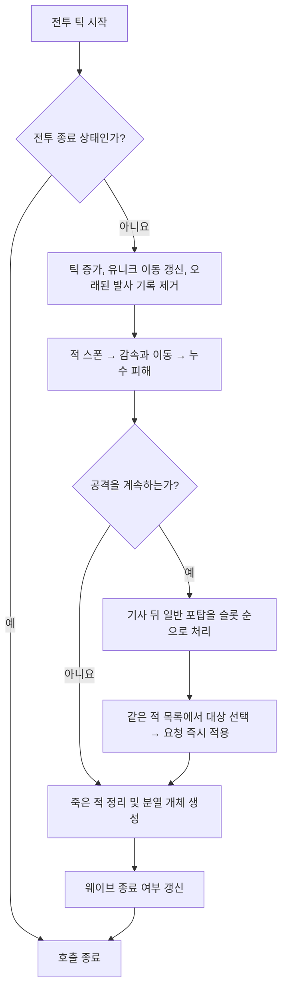
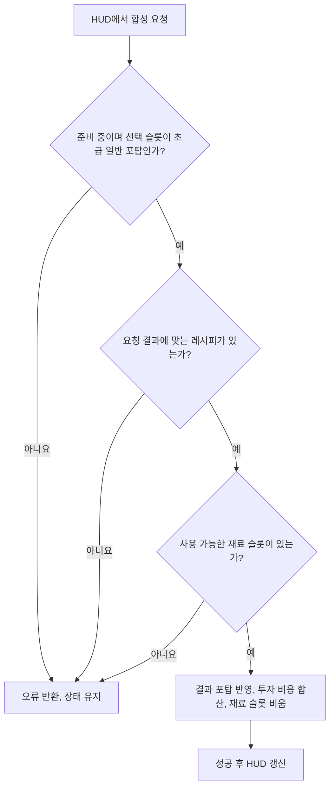
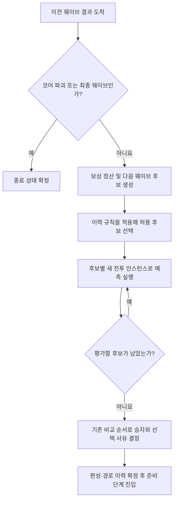

# 타워디펜스

[포트폴리오](https://github.com/mjcjc/Portfolio) · [포트폴리오의 타워디펜스 소개](https://github.com/mjcjc/Portfolio/blob/main/tower-defense.md)

공통 `Tower` 클래스를 두고 포탑별로 달라지는 동작을 하위 클래스에서 구현한다. 포탑은 공격과 효과를 결정하고, 전투 시뮬레이션은 실행 순서와 결과를 관리한다. 아래 클래스와 파일명은 검토용 제안이다.

## 포탑 클래스

| 스크립트 | 책임 |
|---|---|
| `Tower.cs` | 포탑의 공통 계약을 정의한다. 한 틱에 공격이나 효과를 요청하거나 아무 요청도 만들지 않을 수 있다. |
| `RangedTower.cs` | 사거리 안의 적을 고르고 재사용 대기시간이 끝나면 공격을 요청한다. 연사탑, 저격탑, 레일건은 각자의 수치로 이 동작을 공유한다. |
| `ArtilleryTower.cs` | `RangedTower`를 상속해 명중 지점 주변까지 피해를 주는 공격을 요청한다. |
| `SlowTower.cs` | 주변 적에게 감속 효과를 제공한다. 냉각포는 범위 공격과 감속 효과를 조합한다. |
| `KnightTower.cs` | 지킬 슬롯을 기준으로 적을 골라 추격하고 근접 거리에서 공격한다. 적이 없으면 지킬 위치로 복귀한다. |
| `TowerDefinition.cs` | 피해량, 사거리, 공격 간격, 범위 반경, 보호막 배율 등 밸런스 수치를 보관한다. |
| `TowerPlacement.cs` | 슬롯, 종류, 등급, 투자 비용, 유니크 여부, 특화 경로를 보관한다. |
| `TowerFactory.cs` | 배치와 정의를 바탕으로 전투에 사용할 포탑 인스턴스를 생성한다. 실제 전투와 AI 예측이 같은 생성 규칙을 사용한다. |

상속의 단위는 동작 차이로 정한다. 전격탑의 보호막 배율은 정의에서 바꾸고, 기동 기사의 추격 기준은 기사 클래스에서 바꾼다. 범위 공격과 감속을 함께 쓰는 냉각포는 기존 효과를 조합한다.

## 전투·진행·AI·화면

| 영역 | 제안 스크립트 | 책임 |
|---|---|---|
| 전투 진행 | `CombatSimulation.cs` | 스폰, 이동, 공격, 종료의 틱 순서를 조율하고 웨이브 결과를 집계한다. |
| 피해 처리 | `DamageResolver.cs` | 공격 요청을 받아 범위 피해, 보호막 흡수, 체력 차감, 처치를 처리한다. |
| 적 이동 | `EnemyMovement.cs` | 경로를 따라 적을 이동시키고 포탑이 제공한 감속 효과를 기존 판정 기준에 따라 적용한다. |
| 게임 진행 | `RunController.cs` | 준비·전투·종료 상태를 전환한다. 뽑기나 합성에 성공하면 슬롯과 크레딧 변경을 함께 반영한다. |
| 보드·보상 | `TowerBoard.cs`, `CombinationRecipes.cs`, `WaveRewards.cs` | 각각 배치와 교환, 합성 재료와 결과, 웨이브·보급·도전 보상을 담당한다. |
| AI 판단 | `WaveCandidateGenerator.cs`, `WaveEvaluator.cs`, `EnemyDirector.cs` | 각각 후보 생성, 시뮬레이션을 통한 후보 평가, 최종 선택과 사유 작성을 담당한다. |
| Unity 화면 | `BattleSceneController.cs`, `BattleInput.cs`, `BattlefieldView.cs`, `BattleHud.cs`, `BattleAudio.cs` | 각각 씬 수명주기와 연결, 클릭·드래그 해석, 전장 렌더링, HUD 표시, 오디오를 담당한다. |

현재 구조는 [전투 모델](Assets/Scripts/Domain/GameModel.cs)과 [Unity 씬 컨트롤러](Assets/Scripts/Presentation/BattleSceneController.cs)에서 확인할 수 있다.

## 파일별 클래스와 멤버

아래는 구현 전에 검토할 선언과 책임이다. 전투 객체는 웨이브마다 새로 생성하며, 준비 단계의 배치에는 전투 중 위치나 공격 대기시간을 저장하지 않는다.

### 공유 열거형

`GameEnums.cs`에 `Lane`, `TowerType`, `EnemyType`, `SupplyReward`, `AssaultType`, `ChallengeType`, `UniquePath`, `RunPhase`를 모은다. 기존 `TowerDefense` 네임스페이스와 각 열거형의 이름, 멤버 순서, 숫자 값을 유지한다. 각 클래스는 이 파일의 열거형을 참조한다.

### 포탑과 전투

| 파일 | 들어갈 타입 | 주요 상태와 메서드 |
|---|---|---|
| `Tower.cs` | 추상 클래스 `Tower` | `SlotId`, `Position`, `Definition`, `NextAttackTick`을 가진다. `GetSlowEffect()`는 정의에 감속이 있을 때만 효과를 반환한다. `Step(int tick, List<EnemyRuntime> enemies)`은 해당 틱의 선택적 `AttackRequest`를 반환한다. `Relocate(slot, position)`은 이동이 확정되면 호출된다. |
| `RangedTower.cs` | 클래스 `RangedTower : Tower` | `Step(tick, enemies)`에서 공격 가능 시점을 검사하고, 살아 있는 사거리 내 적 중 코어 도달 예상 시간이 가장 짧은 적을 선택한다. 공격이 성립하면 다음 공격 가능 틱을 기록한다. `CreateAttack(target)`은 기본적으로 단일 대상 공격을 만든다. |
| `ArtilleryTower.cs` | 클래스 `ArtilleryTower : RangedTower` | `CreateAttack(target)`을 재정의해 명중 위치와 범위 반경을 요청에 담는다. 기본 타기팅과 공격 주기는 상속한다. 범위형 전격탑·폭풍포도 정의의 배율과 반경을 전달해 이 동작을 공유할 수 있다. |
| `SlowTower.cs` | 클래스 `SlowTower : Tower` | 공통 `GetSlowEffect()`를 사용하고, `Step(tick, enemies)`에서는 공격 요청을 만들지 않는다. 냉각포는 `ArtilleryTower`로 생성해 같은 감속 처리와 범위 공격을 함께 사용한다. |
| `KnightTower.cs` | 클래스 `KnightTower : Tower` | `GuardPosition`, `Position`, `FacesLeft`를 갖는다. `Step(tick, enemies)`에서 경계 범위 안의 적 중 기사와 가장 가까운 적을 골라 추격하고, 적이 없으면 복귀한다. 근접 거리 안이고 재사용 대기가 끝나면 공격을 요청한다. `Relocate()`는 새 경계 위치를 반영한다. |
| `TowerDefinition.cs` | 불변 클래스 `TowerDefinition` | 종류, 피해량, 사거리, 공격 간격, 범위 반경, 감속, 보호막 배율을 가진다. 정의는 전투 실행 간 공유한다. |
| `TowerPlacement.cs` | 클래스 `TowerPlacement` | `SlotId`, `Type`, `Rank`, `Invested`, `IsUnique`, `Path`와 복사 연산 `Copy()`를 둔다. |
| `TowerFactory.cs` | 클래스 `TowerFactory` | `Create(placement, position) → Tower`. 등급과 특화 경로를 반영한 수치를 계산하고, 기존의 유니크 연사탑 배치를 기사로 매핑한다. |
| `AttackRequest.cs` | 읽기 전용 구조체 `AttackRequest` | 발사 슬롯, 발사 위치, 대상 식별자, 명중 위치, 피해량, 범위 반경, 보호막 배율을 담는다. |
| `SlowEffect.cs` | 읽기 전용 구조체 `SlowEffect` | 효과 중심, 반경, 감속률을 담는다. 감속값 계산은 공통 포탑 규칙을 사용하고, 유니크 냉각포의 보너스는 정의에서 제공한다. |
| `CombatSimulation.cs` | 클래스 `CombatSimulation` | `Tick`, `CoreHp`, 포탑과 적의 전투 인스턴스, 누수·현상금·발사 기록을 관리한다. `Step()`은 기존 틱 순서를 유지하고, `TryMoveUnique()`는 재배치 시작과 도착 시 슬롯 교환을 조율한다. 재배치 중 공격과 감속 중단도 여기서 적용한다. |
| `DamageResolver.cs` | 클래스 `DamageResolver`, 결과 구조체 `DamageResult` | `Apply(request, enemies) → DamageResult`. 명중 대상과 범위 내 적을 판정하고 보호막과 체력을 갱신한다. 결과에 발사 기록 `Shot`과 이번 공격으로 처치한 적을 담아 시뮬레이션이 현상금과 통계를 집계하게 한다. |
| `EnemyMovement.cs` | 클래스 `EnemyMovement` | `Advance(enemy, effects, route)`에서 유효한 감속 중 가장 강한 효과를 선택하고 경로 진행 거리를 갱신한다. |
| `EnemyRuntime.cs` | 클래스 `EnemyRuntime` | 적 식별자, 경로, 진행 거리, 체력, 보호막과 분열 상태를 보관한다. |
| `Shot.cs` | 클래스 `Shot` | 틱, 발사 슬롯, 시작·명중 좌표, 처치 수를 기록한다. 전투 통계와 화면이 같은 발사 기록을 읽는다. |
| `Route.cs`, `Point.cs` | 각각 클래스 `Route`, 구조체 `Point` | `Route.Position(distance)`는 경로 위치를 계산한다. `Point.Within(other, radius)`는 거리 범위를 판정한다. |

현재 `Rules`에 모인 포탑 수치는 `TowerDefinition`으로, 보상 수치는 `WaveRewards`로 옮긴다. 나머지 공통 상수와 맵 좌표는 1차 분리에서 `Rules.cs`의 정적 클래스 `Rules`로 추출한다.

### 게임 진행, AI, Unity

| 파일 | 들어갈 타입 | 주요 상태와 메서드 |
|---|---|---|
| `RunController.cs` | 클래스 `RunController` | 웨이브, 코어 체력, 크레딧, 뽑기 순서, 확정 편성을 관리한다. `TryDrawTower()`, `TryCombine()`, `TryUpgrade()`, `TrySell()`, `TryStartCombat()`, `StepCombat()`이 게임 명령의 진입점이다. |
| `TowerBoard.cs` | 클래스 `TowerBoard` | 슬롯 배열을 소유한다. `TryPlace()`, `TryMove()`, `GetMatchingSlots()`로 배치와 교환을 처리한다. 비용과 재료 소모를 검증한 뒤 `RunController`가 보드와 크레딧을 함께 갱신한다. |
| `CombinationRecipes.cs` | 클래스 `CombinationRecipes`, 값 타입 `CombinationRecipe` | 레시피에 두 재료와 결과를 담는다. `FindByIngredient()`는 가능한 조합을 반환해 화면과 합성 명령에서 같은 레시피를 사용하게 한다. |
| `WaveRewards.cs` | 클래스 `WaveRewards` | `GetSupplyOptions()`, `CalculateSettlement()`에서 보급 선택지, 웨이브 정산, 도전 보상을 산출한다. `RunController`가 선택의 유효성을 확인하고 보상을 반영한다. |
| `WavePlan.cs` | 클래스 `WavePlan`, 값 타입 `SpawnEntry` | 웨이브의 주력 경로, 공세·도전 유형, 스폰 시각과 적 구성을 전달한다. |
| `WaveCandidateGenerator.cs` | 클래스 `WaveCandidateGenerator` | `CreateOpeningWave()`, `Generate(wave, history)`에서 첫 웨이브와 이후 후보 편성을 만든다. |
| `WaveEvaluator.cs` | 클래스 `WaveEvaluator` | `Evaluate(plan, placements, coreHp) → CandidateEvaluation`. 후보마다 독립된 `CombatSimulation`을 실행하고 피해와 누수를 기록한다. |
| `EnemyDirector.cs` | 클래스 `EnemyDirector`, 결과 타입 `CandidateEvaluation`, `DirectorDecision` | 생성자 `EnemyDirector(WaveCandidateGenerator generator, WaveEvaluator evaluator)`에서 후보 생성기와 평가 객체를 받는다. `SelectPlan()`은 평가 결과의 순위를 정하고 최종 후보와 선택 근거를 반환한다. |
| `BattleSceneController.cs` | `MonoBehaviour` 클래스 `BattleSceneController` | `Awake()`에서 진행 모델과 화면 구성 요소를 연결한다. `Update()`에서 입력과 전투 진행을 호출하고 `OnGUI()`에서 뷰에 그리기를 위임한다. |
| `BattleInput.cs` | 클래스 `BattleInput` | 드래그 시작 슬롯과 선택 상태를 관리한다. `HandlePointer()`가 클릭·드래그를 이동·선택 명령으로 변환한다. |
| `BattlefieldView.cs` | 클래스 `BattlefieldView` | `Draw()`가 경로, 포탑, 적, 발사 효과를 그린다. `FindSlotAt()`으로 입력 처리에 사용할 슬롯 좌표 판정을 제공한다. |
| `BattleHud.cs` | 클래스 `BattleHud` | `Draw()`가 준비·결과·보상·AI 판단 화면을 표시하고, 버튼 동작을 씬 컨트롤러에 전달한다. |
| `BattleAudio.cs` | 클래스 `BattleAudio` | `SetPhase()`, `SetMusicVolume()`, `SetEffectsVolume()`, `PlayPromotion()`을 제공한다. 음악 트랙 전환과 볼륨 저장을 담당한다. |

### 호출 흐름 예시

1. `RunController.TryStartCombat()`이 배치와 확정 웨이브를 전달하면 `TowerFactory`가 일반 포탑과 기사 전투 인스턴스를 만든다.
2. 기사 차례에 `CombatSimulation`이 `KnightTower.Step(tick, enemies)`을 호출한다. 기사가 이동 중이면 위치만 갱신하고, 사거리와 공격 간격이 충족되면 `AttackRequest`를 반환한다.
3. `DamageResolver`가 범위와 보호막을 판정한다. 시뮬레이션이 처치와 현상금을 집계하고, 화면은 `Shot` 기록으로 공격을 표시한다.
4. AI는 후보마다 새 전투 인스턴스를 생성하고 같은 과정을 실행한다. 후보별 기사 위치와 대기시간은 해당 시뮬레이션 인스턴스가 소유한다.

## SOLID 적용 기준

| 원칙 | 확인 기준 |
|---|---|
| SRP · 단일 책임 | 기사 추격은 `KnightTower`, 공통 피해 공식은 `DamageResolver`, 합성 재료는 `CombinationRecipes`에서 수정한다. |
| OCP · 개방-폐쇄 | 기존 공격 요청으로 표현 가능한 새 동작은 하위 클래스와 생성 연결을 추가해 적용한다. 전투 시뮬레이션의 틱 순서는 그대로 쓸 수 있다. |
| LSP · 리스코프 치환 | 원거리 포탑, 감속탑, 기사를 같은 `Tower` 계약으로 실행할 수 있다. 공격과 효과 요청은 선택적으로 발생한다. |
| ISP · 인터페이스 분리 | 포탑의 `Step()`에는 현재 틱과 기존 적 목록을 전달한다. 적 목록에는 추가·삭제를 하지 않고 대상만 선택한다. HUD는 표시 상태를 읽고 입력 처리는 진행 명령을 호출한다. |
| DIP · 의존성 역전 | 시뮬레이션은 구체 포탑 대신 추상 클래스 `Tower`에 의존한다. AI 디렉터는 구체 클래스 `WaveEvaluator`를 생성자로 받는다. AI 평가의 생성과 선택 책임은 분리되며, 평가 구현에 대한 구체 의존성은 유지한다. |

## 변경 전후 비교

| 변경 상황 | 현재 | 설계 적용 후 |
|---|---|---|
| 기사 추격 방식 변경 | `CombatSimulation`을 수정한다. | `KnightTower`에서 변경한다. |
| 전격탑의 보호막 배율 변경 | 공용 피해 처리에서 전격탑과 폭풍포의 조건을 확인한다. | 전격탑의 정의에서 배율을 변경한다. |
| 모든 공격의 보호막 흡수 공식 변경 | `CombatSimulation.ApplyShot()`을 수정한다. | `DamageResolver`의 공통 공식을 수정한다. |
| 기존 포탑의 합성 조합 추가 | `RunController`의 조합 분기를 확인한다. | `CombinationRecipes`에 항목을 추가한다. |

## 상태 소유권과 변경 경계

| 상태 | 쓰기 책임 | 읽기와 전달 |
|---|---|---|
| 준비 보드 및 슬롯별 배치 | `TowerBoard`. `RunController`의 명령 또는 실제 전투의 이동 완료 결과만 반영한다. | 화면은 표시용 조회를 사용한다. 전투와 AI에는 배치 사본을 넘긴다. 외부 슬롯 번호는 기존 1부터 시작하는 `SlotId`를 유지하며 배열 인덱스와의 변환은 보드 경계에서 한다. |
| 크레딧, 단계, 웨이브, 보급 수령 여부 | `RunController`. 명령의 검증에 성공한 뒤 보드 변경과 함께 반영한다. | HUD는 조회 결과를 표시한다. `WaveRewards`는 보상안을 계산해 반환한다. |
| 전투 틱, 적 목록, 누수, 코어 체력, 감속과 처치 집계 | 각 `CombatSimulation` 인스턴스. 피해와 이동 갱신은 각각 `DamageResolver`와 `EnemyMovement`에 위임한다. | 실제 전투의 진행 결과만 `RunController`에 반영한다. AI 후보의 결과는 평가 점수로 사용한다. |
| 포탑 위치, 발사 대기시간, 기사 방향 | 각 `Tower` 인스턴스. 기사 추격 위치와 경계 위치는 `KnightTower`가 관리한다. | 유니크 재배치는 전투 시뮬레이션이 조율한다. 슬롯을 바꿔도 공격 대기시간은 포탑 인스턴스를 따라간다. |
| 확정 웨이브 및 주력 경로 이력 | `RunController`. `EnemyDirector`가 반환한 결과를 채택하며 이력을 갱신한다. | `WavePlan`은 전투 시작 시 스냅샷으로 고정한다. 준비 중 도전 선택으로 편성이 바뀌면 새 편성을 만든다. |
| 화면의 선택·드래그, 음량과 재생 상태 | 선택과 드래그는 `BattleInput`, 음량과 재생은 `BattleAudio`. | 화면 명령은 씬 컨트롤러를 거쳐 진행 모델에 전달한다. |

## 현재 메서드의 이동 위치

| 현재 위치 | 설계 적용 후 |
|---|---|
| `CombatSimulation.Step()`, `SpawnReadyEnemies()`, `DamageCoreForEscapedEnemies()` | `CombatSimulation`에서 틱·스폰·누수 순서를 관리한다. |
| `MoveEnemies()`, `FindTarget()`, `AttackWithTowers()` | 이동과 감속은 `EnemyMovement.Advance()`, 일반 타깃 선택과 발사 요청은 `RangedTower.Step()`, 슬롯 순회와 요청 실행은 `CombatSimulation.Step()`으로 분리한다. |
| `MoveAndAttackWithKnight()`, `TryMoveMobile()` | 추격·복귀·공격은 `KnightTower.Step()`, 유니크 재배치 검증과 슬롯 확정은 `CombatSimulation`으로 간다. |
| `ApplyShot()` | 범위 피해와 보호막 계산은 `DamageResolver.Apply()`. `DamageResult`를 받아 현상금·냉각포 기록·처치를 집계하는 책임은 `CombatSimulation`에 둔다. |
| `RunController.TryGetRecipe()`, `FindRecipeIngredient()`, `TryCombine()` | 레시피 선택은 `CombinationRecipes`, 재료 슬롯 탐색은 `TowerBoard`, 명령 검증과 변경 확정은 `RunController.TryCombine()`에 둔다. |
| `TryPlace()`, `MatchingTowers()`, `TryMove()` | 슬롯 검사, 배치, 같은 등급 탐색, 교환은 `TowerBoard`. 가격·단계·성공 여부를 처리하는 명령은 `RunController`. |
| `TryClaimSupply()`, `StepCombat()` | 보상 조건과 금액은 `WaveRewards`. 보급 중복 검증, 실제 전투 결과 반영과 다음 단계 전환은 `RunController`. |
| `EnemyDirector.FirstWave()`, `CreatePlan()`, `SelectPlan()` | 첫 웨이브와 후보 편성은 `WaveCandidateGenerator`, 시뮬레이션 반복은 `WaveEvaluator`, 순위와 선택 사유는 `EnemyDirector`. |
| `BattleSceneController.HandleSlotInput()`, `SlotAt()`, `DrawMap()`, `DrawPreparation()`, `DrawDirector()`, `InitializeMusic()`, `UpdateMusic()` | 입력은 `BattleInput`, 좌표 판정과 전장 그리기는 `BattlefieldView`, 준비와 AI 화면은 `BattleHud`, 음악은 `BattleAudio`. |

## 전투 한 틱

`Step()`이 호출될 때마다 기존 틱 순서를 보존한다. 기사 공격 뒤 일반 포탑은 슬롯 순으로 처리한다. 모든 포탑의 `Step(tick, enemies)`에 시뮬레이션이 소유한 같은 적 목록을 전달한다. 목록과 적 객체를 복사하지 않는다. 포탑은 목록과 적 상태를 변경하지 않고 대상만 선택하며, `DamageResolver`는 반환된 요청을 다음 포탑의 차례 전에 적용한다. 목록과 객체가 가변이므로 이 경계는 호출부와 코드 리뷰에서 확인한다. 같은 틱의 앞선 공격으로 죽은 적은 뒤 포탑의 타깃이 될 수 없다. 분열 개체는 정리 단계에 생성하므로 해당 틱의 공격 대상에는 포함되지 않는다.

실제 전투에서 코어가 파괴되면 남은 공격을 건너뛴다. 예측은 총 예상 피해를 집계하기 위해 코어가 0이어도 웨이브를 끝까지 진행한다. 유니크 이동 대상이 잘못됐거나 이미 이동 중이면 이동 요청을 거부한다. 유효한 이동은 도착 틱에만 두 슬롯을 교환하고, 이동 중에는 해당 포탑의 공격과 감속을 중단한다. 실제 전투의 교환은 도착 결과를 통해 준비 보드에도 반영한다.

## 합성 명령과 실패 처리

예를 들어 포격탑을 선택하고 폭풍포 조합을 요청하면, `CombinationRecipes`가 요청한 결과에 맞는 전격탑 재료를 찾는다. 결과를 지정하지 않은 포격탑 조합은 기존 냉각포 우선순위를 유지한다. 재료의 적격 조건과 슬롯 탐색 순서는 현재 `FindRecipeIngredient()`와 일치시킨다.

이 합성은 크레딧을 차감하지 않는다. 성공 시 선택 슬롯과 투자 비용 합계가 유지된다. 실패한 요청은 포탑 종류, 슬롯, 투자 비용, 크레딧을 변경하지 않는다. 해당 변경은 모든 검사 뒤 한 번의 보드 명령으로 반영한다. 뽑기나 유니크 승급처럼 크레딧이 드는 명령도 유효성 및 비용을 먼저 검증하고 성공 시 보드와 크레딧을 함께 반영한다.

## AI 예측과 웨이브 전환

후보 생성 시 같은 경로가 두 번 연속 주력이었다면 해당 경로를 제외한다. 모든 후보는 같은 준비 배치와 시작 코어 체력에서 실행한다. 각 후보에 별도의 포탑, 적 목록, 발사 기록이 생기며 불변 포탑 정의만 공유한다. 후보 점수의 비교 순서와 동률 처리는 기존 `EnemyDirector.Compare()`를 유지한다. 이후 전투 시작 명령이 들어오면 확정 편성과 **그 명령 시점의** 준비 배치로 실제 전투를 생성한다. 따라서 첫 예측 이후 플레이어가 포탑을 옮겼다면 결과가 달라질 수 있다.

## 성능 비교 기준

스냅샷을 포탑마다 생성하는 설계에 비해 적 목록의 복사와 배열 할당이 빠진다. 타깃 탐색 순회는 유지하며, 현재 코드도 같은 적 목록을 직접 탐색한다. 구현 시에는 같은 포탑 배치와 웨이브에서 기존 코드와 AI 후보 평가 시간 및 틱당 GC 할당량을 비교한다.

## 적용 시 검증

1. 기동 기사와 일반 원거리 포탑을 같은 `Tower` 계약으로 실행하고, 기사 추격·복귀와 일반 공격 주기가 기존과 같은지 확인한다.
2. 기존 모델 검증을 변경 전후에 실행하고, 범위 피해·감속·보호막 판정 결과를 비교한다.
3. 동일한 초기 조건에서 실제 전투와 AI 예측의 공통 판정을 비교한다. 평가마다 전투 인스턴스를 새로 생성하고, 평가를 반복해도 실제 배치와 기사 위치 및 재사용 대기시간이 보존되는지 확인한다.
4. 같은 틱의 연속 공격이 이미 처치된 적을 고르지 않는지, 분열 개체가 다음 틱부터 공격 대상에 포함되는지 확인한다.
5. 합성 재료 부족·잘못된 단계에서 보드와 크레딧이 유지되는지, 포격탑의 기본 조합과 폭풍포 지정 조합이 각각 올바른 재료를 소모하는지 확인한다.
6. 전투 중 유니크가 차 있는 슬롯으로 이동할 때 도착 틱, 교환 전후 포탑의 대기시간, 준비 보드 반영을 비교한다.
7. 화면을 분리하는 단계에서는 Unity에서 드래그 이동, HUD 갱신, 오디오 동작을 확인한다.

## Unity 데모 실행과 에셋 출처

Unity 2022.3.56f1에서 이 폴더를 프로젝트로 연다. 초기 임포트가 끝나면 Title/Battle 씬이 자동 생성되고 첫 실행에서 타이틀 화면이 열린다.

Git으로 내려받은 프로젝트에서 기존 외형을 재현하려면 로컬 작업본의 `Assets/Resources/Cartoon/`과 `Assets/Resources/Korean.ttf`를 같은 경로에 둔다. 캐릭터팩과 Windows 글꼴 파일은 각 라이선스에 따라 저장소 밖에서 관리한다.

- 방어 시작을 누르고 뽑기 버튼으로 25크레딧을 써서 초급 포탑을 무작위 빈 슬롯에 바로 배치한다. 연사·포격·감속·저격·전격이 한 묶음에 한 번씩 무작위 순서로 나온다.
- 첫 웨이브에서 두 번 뽑으면 빠진 조합 재료 하나 또는 뽑기 한 번분의 크레딧을 받을 수 있다. 첫 전투는 북쪽 슬라임 군집과 남쪽 정찰병으로 시작한다.
- 같은 종류와 등급의 포탑이 3개 모이면 남길 포탑을 클릭해 합성한다. 초급 3개는 중급 1개가 되고, 중급 3개는 고급 1개가 된다. 재료가 된 두 슬롯은 비워진다.
- 중급 포탑에는 방패가 달리고 고급 포탑에는 왕관도 생긴다. 합성이나 보급으로 승급하면 빛과 효과음이 나온다.
- 타이틀과 전투 화면에서 음악과 효과음 볼륨을 따로 조절할 수 있다.
- 서로 다른 초급 포탑도 조합할 수 있다. 포격탑과 감속탑은 범위 공격과 감속을 겸하는 냉각포가 된다. 연사탑과 저격탑은 먼 거리에서 빠르게 쏘는 레일건이 된다. 한쪽 포탑을 선택하고 조합 버튼을 누르면, 버튼에 표시된 슬롯의 재료를 사용해 선택한 자리에 새 포탑이 생긴다.
- 기존 포탑을 클릭하면 판매·이동을 선택할 수 있다.
- 준비 중에는 포탑을 빈 슬롯으로 드래그해 횟수 제한 없이 옮길 수 있다.
- 공격 예고를 확인한 뒤 전투 시작을 누른다.
- 5웨이브마다 전투 전에 추가 크레딧, 코어 수리, 선택한 초급 포탑의 중급 승급 중 하나를 받을 수 있다.
- 5·15·25웨이브에는 주력 경로로 슬라임 떼가 몰리고, 10·20웨이브에는 강화 중장갑이 먼저 들어온다. 예고에서 공세 종류와 주력 경로를 확인할 수 있다.
- 특수 공세 준비 화면에서 군집 또는 중장갑 증원 도전을 고를 수 있다. 증원 경로를 돌파 0명으로 막으면 추가 크레딧 100 또는 즉시 승급권을 받는다. 승급권은 다음 전투가 시작되기 전에 선택한 초급·중급 포탑에 사용한다.
- AI 판단 보기에서 후보별 예상 피해와 선택 기준을 확인한다.
- 30웨이브까지 코어를 지키면 승리, 코어 내구도 0이면 패배한다. 후반으로 갈수록 적의 수와 등장 밀도가 늘고, 정찰병과 중장갑병의 체력도 증가한다.
- Windows 실행 파일은 Unity 메뉴 Tower Defense > Build Windows Demo로 만든다.

캐릭터와 맵 소품에는 Tiny Tileset의 Free Cartoon Starter Pack을 사용한다. 규칙 수치는 Assets/Scripts/Domain/GameModel.cs의 Rules와 EnemyDirector에 있다.

- 타이틀·준비 음악은 Fablefly Music의 [Lily-Paddling Down the Stream](https://fablefly-music.itch.io/lily-paddling-down-the-stream)이다. [CC BY 4.0](https://creativecommons.org/licenses/by/4.0/) 조건으로 사용하며 원본 오디오를 반복 재생한다.
- 전투 음악은 Fupi의 [Empacotatron](https://opengameart.org/content/empacotatron) 루프다. CC0이며, 다음 전투가 시작되면 이전 재생 위치에서 이어진다.

Tests/ModelChecks.cs는 Unity 외부에서 실행할 수 있는 전투 모델 검증 진입점이다. 초기 웨이브 편성, 전투와 예측의 판정 일치, 실제 뽑기와 합성으로 30웨이브 생존이 가능한지 검증한다.
